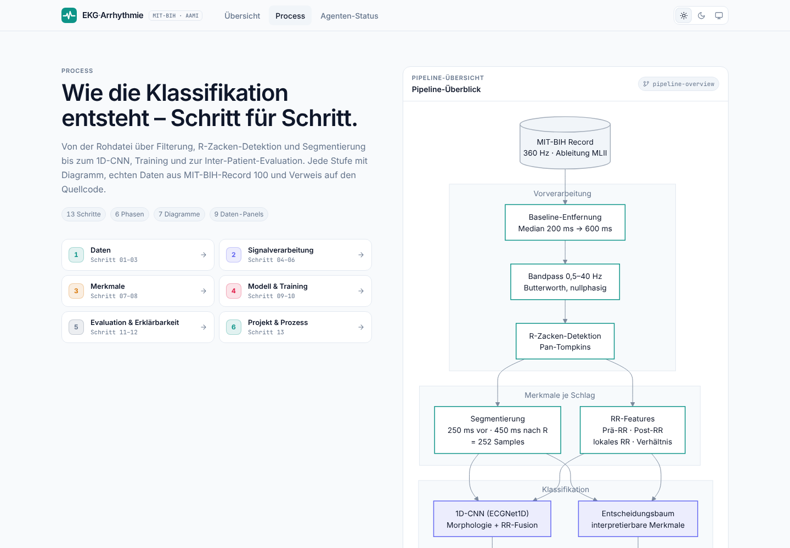
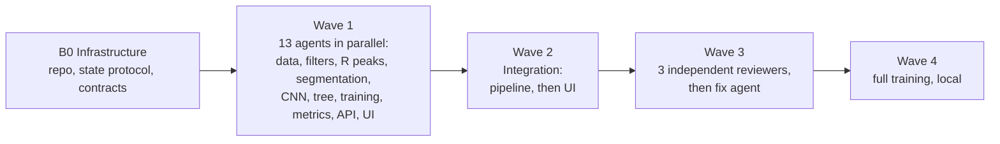

# ECG Arrhythmia Detection on MIT-BIH (AAMI EC57, inter-patient)

[Deutsch](README.md) · **English**

A compact 1D-CNN and an interpretable decision tree assign individual heartbeats from the MIT-BIH
Arrhythmia Database to the five AAMI EC57 classes **N, S, V, F, Q** – evaluated strictly
**inter-patient** (training and test on different people) and built with **orchestrated AI
agents**.

**Live demo:** <https://leonrohrer.at/ekg-arrhythmia/> – shows every step from the raw signal to
the class, with diagrams and real data.



> Learning and portfolio project. **Not a medical device**, not suitable for diagnosis.

## At a glance

| | |
|---|---|
| **Data** | MIT-BIH Arrhythmia Database (PhysioNet), lead MLII, 360 Hz. 44 of 48 records; the 4 paced records (102, 104, 107, 217) are excluded as recommended by AAMI. |
| **Split** | de Chazal et al. (2004): DS1 (22 records) for training only, DS2 (22 records) for testing only. No record is in both sets; only 201 (DS1) and 202 (DS2) come from the same person, a known quirk of this split. |
| **Classes** | N (normal, bundle branch block, escape beats), S (supraventricular ectopic), V (ventricular ectopic), F (fusion), Q (unclassifiable). |
| **Models** | `ECGNet1D` (3 convolution blocks + RR branch, 14,749 parameters) and a decision tree (depth 4, 11 readable features). |
| **Main metrics** | Sensitivity and PPV per class, macro-F1 over N/S/V/F. Accuracy is not a headline number: about 89 % of the test beats are normal, so a model that always says "N" already looks good. |
| **Interface** | Vite, Tailwind CSS v4, Mermaid; German/English, light/dark; static on GitHub Pages. |

## Results

Evaluation is on DS2 using the R-peak positions of the expert annotations (as in de Chazal). The
tables show the EC57 "gross" statistics, i.e. pooled over all test records, with the standard's
VEB rule: true fusion beats classified as V are not counted as false alarms for V.

<!-- METRICS:START -->
<!-- preliminary: values from web/public/data/metrics.json (generated_at 2026-11-02T11:06:14+00:00, second DS2 evaluation, see Methodology transparency). The main session replaces this block after the final DS2 evaluation (plan A7). Keep the de Chazal column (literature values, source below) when replacing. -->

> **Preliminary.** These values come from the second evaluation of DS2 and will be replaced after
> the single final evaluation (see [Methodology transparency](#methodology-transparency)).

**1D-CNN** (validation on DS1 records 114, 119, 122, 201; best model after epoch 2 of 7):

| Class | Sensitivity | PPV | F1 | Beats in DS2 |
|---|---:|---:|---:|---:|
| N | 92.0 % | 97.5 % | 94.7 % | 44,240 |
| S | 69.0 % | 40.2 % | 50.8 % | 1,837 |
| V | 79.2 % | 93.6 % | 85.8 % | 3,220 |
| F | 1.0 % | 0.2 % | 0.3 % | 388 |
| Q | 0.0 % | 0.0 % | 0.0 % | 7 |

- **Macro-F1 (N/S/V/F): 0.579** · macro-F1 over all 5 classes: 0.463
- Accuracy 89.6 % – for comparison: "always N" reaches 89.0 %.
- Largest error source: 2,018 normal beats are labelled F, while F itself is almost never hit.

Confusion matrix of the CNN (rows = true class, columns = prediction):

| | N | S | V | F | Q |
|---|---:|---:|---:|---:|---:|
| **N** | 40,691 | 1,496 | 35 | 2,018 | 0 |
| **S** | 391 | 1,268 | 139 | 39 | 0 |
| **V** | 252 | 387 | 2,550 | 31 | 0 |
| **F** | 380 | 2 | 2 | 4 | 0 |
| **Q** | 6 | 1 | 0 | 0 | 0 |

**Decision tree** (depth 4, trained on all of DS1): macro-F1 (N/S/V/F) 0.356.
Sensitivity / PPV: N 60.0 % / 95.0 % · S 7.1 % / 1.9 % · V 82.4 % / 54.9 % · F 1.8 % / 0.1 %.
The tree is deliberately small and readable; it shows how far simple features go, especially
for V.

**Cross-validation on DS1 only** (5 record-grouped folds × 3 seeds, macro-F1 N/S/V/F,
mean ± standard deviation): `base` 0.459 ± 0.020 · `rr` 0.463 ± 0.023 ·
`patient` 0.481 ± 0.024. This is the baseline for all further model decisions.

**R-peak detection** (Pan-Tompkins, record 100 only, tolerance ±150 ms): 2,273 of 2,273 beats
found, 0 false detections. A single record is not a benchmark.

### Comparison with de Chazal et al. (2004)

| Metric | this project (CNN, preliminary) | de Chazal et al. 2004 |
|---|---:|---:|
| N sensitivity | 92.0 % | 86.9 %¹ |
| N PPV | 97.5 % | 99.2 %¹ |
| S sensitivity | 69.0 % | 75.9 % |
| S PPV | 40.2 % | 38.5 % |
| V sensitivity | 79.2 % | 77.7 % |
| V PPV | 93.6 % | 81.9 % |

In the preliminary run the CNN is at a similar or higher level for V and for S PPV, and lower
for S sensitivity. The numbers are only partly comparable (conditions below).

¹ N values from a secondary source, see below.
<!-- METRICS:END -->

**Source and conditions of the comparison.** P. de Chazal, M. O'Dwyer, R. B. Reilly: *Automatic
Classification of Heartbeats Using ECG Morphology and Heartbeat Interval Features.* IEEE
Transactions on Biomedical Engineering 51(7), 1196–1206, 2004.
[doi:10.1109/TBME.2004.827359](https://doi.org/10.1109/TBME.2004.827359). The S and V values are
stated in the paper's abstract. The N values come from the comparison table in Tan et al. 2019
([arXiv:1906.07361](https://arxiv.org/abs/1906.07361), Table VI); I have not seen the original
table. Identical: split (DS1 → DS2), classes, EC57 conventions and the use of expert R peaks.
Different: de Chazal uses **two** leads and linear discriminants on hand-crafted features, this
project uses MLII only and a CNN. Also, DS2 was already evaluated more than once here before the
final run.

## Limitations

- **Small data basis.** The MIT-BIH database contains 48 records from 47 people, recorded
  1975–1979; 44 are used, 22 for testing. The result says little about how the model behaves on
  other devices, leads or patient groups. An external test (e.g. MIT-BIH Supraventricular
  Arrhythmia Database) is being considered but not done yet.
- **F is practically not learnable.** 373 of the 415 F beats in DS1 come from a single record
  (208). In essence the model sees the fusion beats of one person.
- **Q cannot be evaluated meaningfully.** After excluding the paced records, 8 Q beats remain in
  DS1 and 7 in DS2. That is why macro-F1 over N/S/V/F is the headline number.
- **Reference R peaks.** The main evaluation uses the expert beat positions. A fully automatic
  chain with Pan-Tompkins (`--detected-peaks`) is built in but not yet evaluated on DS2.
- **One lead, offline.** MLII only. The patient-relative features (`--features patient`) use
  statistics over the whole record, i.e. retrospective Holter analysis, not real time.
- **Unstable training.** Model selection on a few validation records varies strongly between
  seeds and folds (details in [docs/EXPERIMENTS.md](docs/EXPERIMENTS.md)).
- **Not a medical device.** Not clinically validated, not for diagnosis or treatment.

## Methodology transparency

The DS2 test split should be evaluated exactly once, at the very end. So far that has not been
achieved here, and saying so openly is part of the project:

1. **First run:** CNN with validation on DS1 records 114, 122, 201 and 208, evaluation on DS2.
2. **Second run:** It then became clear that record 208 holds about 90 % of all DS1 F beats and,
   sitting in validation, was missing from training. The new rule ("no record with ≥ 40 % of a
   class in validation") was derived from DS1 counts only. But the retraining happened with the
   first DS2 result known, and DS2 was evaluated a second time. The current numbers come from
   this second run and are therefore slightly optimistic and **preliminary**.
3. **After that:** feature variants were compared only by cross-validation on DS1. The best
   variant (`patient`) narrowly missed the threshold fixed in advance and was not adopted; DS2
   was not touched for this.

**Rule from now on** (details in [docs/EXPERIMENTS.md](docs/EXPERIMENTS.md) and
[docs/PLAN.md](docs/PLAN.md), both in German):

- All decisions (features, weights, thresholds, epochs) are made via record-grouped 5-fold
  cross-validation on DS1 with 3 seeds.
- The criterion is fixed beforehand: a variant replaces the baseline only if its mean macro-F1
  (N/S/V/F) is at least one standard deviation higher and N sensitivity does not drop.
- Every experiment is logged with date, configuration and result.
- The final configuration is committed before the evaluation. DS2 is then evaluated **exactly
  once** and reported, whatever the result.

## Built with AI agents

The project is also an experiment in building a software project with many AI agents at once
without results and code drifting apart. An orchestrator ("Mother-Agent", Claude) breaks the work
into modules and starts sub-agents for them, up to 16 in parallel. Plan, contracts and status live
as files in the repo: [MASTERPLAN.md](MASTERPLAN.md), [INTERFACES.md](INTERFACES.md) and
[project_state.json](project_state.json) (written in German).

### Process



- **B0:** The orchestrator sets up the repo, the state protocol and the contracts.
- **Wave 1:** 13 agents build data loader, filters, R-peak detection, segmentation, CNN, tree,
  training loop, metrics, API server and the UI building blocks at the same time. Each agent has
  its own, non-overlapping files.
- **Wave 2:** Integration of the pipeline (CLI, web export, tests), then of the interface (build,
  browser tests in light/dark, desktop/phone).
- **Wave 3:** Three reviewers independently check ML correctness and leakage, tests, UI and the
  honesty of the claims. A fix agent reproduced and fixed all 17 findings, e.g. threshold recovery
  in the Pan-Tompkins detector, the QRS width, capped class weights and a cache key with a code
  hash.
- **Wave 4:** physionet.org was blocked in the cloud environment, so there were no metrics there.
  Full training then ran locally on Windows, including a port of the file lock.

### Rules for working together

- **Ownership:** Each module exclusively owns the files under `owns` in `project_state.json`.
  Other modules' files are not edited.
- **Contracts:** `INTERFACES.md` fixes function signatures, data formats and design tokens.
  Anyone who has to deviate logs it with `state.py log` instead of changing things silently; the
  extensions are traceable in each module's history.
- **State lock:** `project_state.json` is changed only through `scripts/state.py`: a file lock
  (`fcntl`, or `msvcrt` on Windows) and atomic writes, so parallel agents never overwrite each
  other.
- **Dependencies:** The orchestrator starts a module only when all of its `depends_on` are done.
  If a module fails (`state.py fail` with a log excerpt), the instruction is corrected and the
  module restarted.
- **Evidence:** Every completion records a summary, decisions, changed files and the tests that
  were run with their result. The status page of the web UI shows this state.

### What I decided and checked myself

- **Goal and guardrails:** the task and its frame (EC57 classes, inter-patient after de Chazal,
  CNN plus an interpretable comparison model, a traceable interface) and the rule not to show
  invented or embellished numbers and to name weaknesses.
- **Local phase:** data and full training on my own machine after the cloud environment could not
  load the database.
- **Course after the first results:** improve the model first, then publish; DS2 stays locked
  until the final evaluation ([docs/PLAN.md](docs/PLAN.md)).
- **Control:** checking metrics in texts against the exported results; the repo only goes public
  after a check for private data.

### Agent protocol (short version)

```bash
python scripts/state.py start <module> --agent <name>
python scripts/state.py done  <module> --agent <name> --summary "…" --decision "…" --file <path> --test "<command>: <result>"
python scripts/state.py fail  <module> --agent <name> --error "<log excerpt>"
python scripts/state.py log   <module> --agent <name> --note "deviation from contract …"
python scripts/state.py show  [<module>]
```

## Architecture

```
Raw signal (MLII, 360 Hz)
  → baseline removal (median 200 ms, then 600 ms)
  → band-pass 0.5–40 Hz (4th-order Butterworth, zero-phase)
  → R peaks (expert annotations; alternatively Pan-Tompkins)
  → segmentation (250 ms before / 450 ms after R = 252 samples, z-normalised) + 4 RR features
  → ECGNet1D (3 × Conv1d/BN/ReLU/MaxPool, 16/32/64 channels, RR branch)
    and decision tree (11 interpretable features, depth 4)
  → AAMI class N/S/V/F/Q → sensitivity, PPV, F1 per class, macro-F1
```

| Package | Contents |
|---|---|
| `ekg.data.loader` | Load records (wfdb), AAMI mapping, DS1/DS2 split, download |
| `ekg.preprocessing.filters` | Baseline removal, band-pass, notch, frequency response |
| `ekg.preprocessing.rpeaks` | Pan-Tompkins detector, intermediate stages, matching against reference |
| `ekg.preprocessing.segmentation` | Beat windows, RR features, `BeatSet` |
| `ekg.preprocessing.patient_features` | RR and beat shape relative to the beat's own record |
| `ekg.models.cnn1d` | `ECGNet1D`, architecture description |
| `ekg.models.tree_baseline` | Features, decision tree, export (JSON/Mermaid) |
| `ekg.training.train` | Training loop (capped class weights, early stopping, cosine schedule, augmentation) |
| `ekg.evaluation.metrics` | Confusion matrix, AAMI metrics, gross/average statistics with VEB rule |
| `ekg.pipeline` | CLI: `demo`, `prepare`, `train`, `cv`, `smoke`, `export-state` |
| `ekg.api.server` | FastAPI: `/api/health`, `/api/state`, `/api/data/{name}`, built UI |

The web interface (`web/`) has four views: **Overview** (with a rhythm player on record 100),
**Process** (every step with a diagram, real data and a pointer to the code), **Models** (CNN and
tree against random baselines) and **Agent status** (from `project_state.json`). The live site is
built statically by [GitHub Actions](.github/workflows/pages.yml) (`VITE_STATIC_SITE=1`, no API).

## Quickstart

Requirements: Python ≥ 3.11 and Node.js ≥ 18. Tested on Linux (cloud container) and Windows 11
with Python 3.13.

**Linux/macOS** (with `make`):

```bash
make install   # .venv, pip install -c constraints.txt -e . pytest, npm ci
make test      # Python tests
make demo      # web exports from record 100 into web/public/data
make web       # build the UI (web/dist)
make serve     # http://127.0.0.1:8000 (API + UI)
```

**Windows** (PowerShell, without `make`): run the Makefile commands directly; the venv's Python
is `.venv\Scripts\python.exe` instead of `.venv/bin/python`.

```powershell
python -m venv .venv
.venv\Scripts\python.exe -m pip install -c constraints.txt -e . pytest
cd web; npm ci; cd ..
.venv\Scripts\python.exe -m pytest -q
.venv\Scripts\python.exe -m ekg.pipeline demo --record data/sample/100 --out web/public/data --data-dir data/mitdb
cd web; npm run build; cd ..
.venv\Scripts\python.exe -m ekg.api.server --port 8000
```

`constraints.txt` pins the tested package versions from the Linux container. If a version does
not exist for your system, install without `-c constraints.txt`. `train` and `cv` write the
versions actually used into their output (`config.library_versions`). For development,
`cd web; npm run dev` starts the UI with hot reload; `/api` is proxied to port 8000.

## Commands

Run all commands from the repo root. On Windows, replace `python` with `.venv\Scripts\python.exe`.

| Purpose | `make` | direct |
|---|---|---|
| Download MIT-BIH (~100 MB, into `data/mitdb`) | `make data` | `python scripts/download_mitdb.py --data-dir data/mitdb` |
| Web exports from record 100 | `make demo` | `python -m ekg.pipeline demo --record data/sample/100 --out web/public/data --data-dir data/mitdb` |
| Mechanics test (1 epoch, `artifacts/smoke/` only) | `make smoke` | `python -m ekg.pipeline smoke --record data/sample/100 --out artifacts/smoke` |
| Beat cache for DS1/DS2 | `make prepare` | `python -m ekg.pipeline prepare --data-dir data/mitdb --cache artifacts/beats` |
| Cross-validation on DS1 only | `make cv FEATURES=base` | `python -m ekg.pipeline cv --data-dir data/mitdb --features base` |
| Train on DS1, **evaluate on DS2** | `make train EPOCHS=20` | `python -m ekg.pipeline train --data-dir data/mitdb --out artifacts --export web/public/data --epochs 20` |
| Copy status for the UI | `make state` | `python -m ekg.pipeline export-state --out web/public/data` |

> `train` evaluates on DS2. In this project that happens only once more, with the frozen final
> configuration (see [Methodology transparency](#methodology-transparency)). Use `cv` for all
> experiments.

`prepare` and `train` exit with code 2 and a list of missing records as long as DS1/DS2 are
incomplete. `demo` does not overwrite an existing `metrics.json` or `dataset_stats.json` with
`status: "complete"` (unless `--force` is given).

### `cv` options

`cv` trains the CNN record-grouped in k folds on DS1 only (DS2 is never loaded), pools the
out-of-fold predictions per seed and reports mean ± standard deviation over the seeds. Output:
`artifacts/cv/cv_<features>[_<tag>].json`.

| Option | Default | Effect |
|---|---|---|
| `--features base\|rr\|patient` | `base` | Extra CNN inputs: 4 RR features; `rr` adds RR relative to the record mean; `patient` also adds the deviation from the record's median beat |
| `--folds K` / `--seeds S …` | `5` / `0 1 2` | Number of folds and seeds |
| `--epochs N` / `--patience P` | `20` / `5` | Maximum epochs; early stopping (`0` = off) |
| `--n-val N` | `3` | Validation records per fold for early stopping. **`--n-val 0`**: no validation, exactly `--epochs` epochs |
| `--eval-epochs E …` | – | Additional out-of-fold evaluation after these epochs (`by_epoch` in the report), to pick a fixed epoch count from one run |
| `--lr-schedule cosine` | off | Cosine learning-rate schedule |
| `--augment` | off | Amplitude ±10 %, Gaussian noise (σ = 0.05 in z-units), time shift ±3 samples |
| `--tag NAME` | – | Suffix of the output file so variants do not overwrite each other |
| `--max-class-share X` | `0.4` | Records holding at least this share of a class never go into validation |
| `--detected-peaks` | off | Pan-Tompkins R peaks instead of expert annotations |

Examples:

```bash
# fixed epoch count without validation, evaluated after 5/10/15/20 epochs
python -m ekg.pipeline cv --features base --n-val 0 --epochs 20 --eval-epochs 5 10 15 20 --tag fixed
# cosine schedule with augmentation
python -m ekg.pipeline cv --features base --n-val 0 --epochs 15 --lr-schedule cosine --augment --tag cos_aug
```

## Project structure

```
├── MASTERPLAN.md          blocks, waves, dependencies of the agents
├── INTERFACES.md          binding interfaces between the modules
├── project_state.json     central status file (change only via scripts/state.py)
├── Makefile
├── constraints.txt        tested Python package versions
├── data/sample/           real MIT-BIH record 100
├── data/mitdb/            full database (after `make data`, not in the repo)
├── docs/
│   ├── PLAN.md            roadmap to publication
│   ├── EXPERIMENTS.md     experiment log (rules, CV runs)
│   └── screenshots/
├── scripts/
│   ├── state.py           lock-safe status protocol for agents
│   └── download_mitdb.py  download of the MIT-BIH database
├── src/ekg/               Python package (see table above)
├── tests/                 pytest (synthetic signals and record 100)
├── artifacts/             models, caches, CV reports (not in the repo)
└── web/
    ├── public/data/       JSON exports of the pipeline for the UI
    └── src/               views, diagrams, charts, process content
```

## License and data

- **Code:** MIT License, see [LICENSE](LICENSE).
- **Data:** MIT-BIH Arrhythmia Database from PhysioNet, licensed under the Open Data Commons
  Attribution License (ODC-By) 1.0. Record 100 in `data/sample/` and the demo exports derived
  from it come from this database. The full database is not in the repo; `make data` downloads it
  from PhysioNet.

## References

- G. B. Moody, R. G. Mark: The impact of the MIT-BIH Arrhythmia Database. *IEEE Engineering in
  Medicine and Biology* 20(3), 45–50, 2001.
- A. L. Goldberger et al.: PhysioBank, PhysioToolkit, and PhysioNet. *Circulation* 101(23),
  e215–e220, 2000.
- P. de Chazal, M. O'Dwyer, R. B. Reilly: Automatic Classification of Heartbeats Using ECG
  Morphology and Heartbeat Interval Features. *IEEE Trans. Biomed. Eng.* 51(7), 1196–1206, 2004.
- J. Pan, W. J. Tompkins: A Real-Time QRS Detection Algorithm. *IEEE Trans. Biomed. Eng.* 32(3),
  230–236, 1985.
- ANSI/AAMI EC57: Testing and reporting performance results of cardiac rhythm and ST segment
  measurement algorithms.
