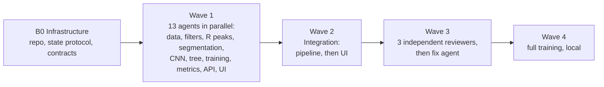

# ECG Arrhythmia Detection on MIT-BIH (AAMI EC57, inter-patient)

[Deutsch](README.md) · **English**

A compact 1D-CNN and an interpretable decision tree assign individual heartbeats from the MIT-BIH
Arrhythmia Database to the five AAMI EC57 classes **N, S, V, F, Q** – evaluated strictly
**inter-patient** (training and test on different people) and built with **orchestrated AI
agents**.

**Live demo:** <https://leonrohrer.at/ekg-arrhythmia/> – shows every step from the raw signal to
the class, with diagrams and real data.


> Learning and portfolio project. **Not a medical device**, not suitable for diagnosis.

## At a glance

| | |
|---|---|
| **Data** | MIT-BIH Arrhythmia Database (PhysioNet), lead MLII, 360 Hz. 44 of 48 records; the 4 paced records (102, 104, 107, 217) are excluded as recommended by AAMI. |
| **Split** | de Chazal et al. (2004): DS1 (22 records) for training only, DS2 (22 records) for testing only. No record is in both sets; only 201 (DS1) and 202 (DS2) come from the same person, a known quirk of this split. |
| **Classes** | N (normal, bundle branch block, escape beats), S (supraventricular ectopic), V (ventricular ectopic), F (fusion), Q (unclassifiable). |
| **Models** | `ECGNet1D`: 3 convolution blocks for the beat shape plus a branch for 10 extra features (RR intervals and patient-relative features), 14,857 parameters; the final model averages 5 such networks (seed ensemble). Plus a decision tree (depth 4, 11 readable features). |
| **Main metrics** | Sensitivity and PPV per class, macro-F1 over N/S/V/F. Accuracy is not a headline number: about 89 % of the test beats are normal, so a model that always says "N" already looks good. |
| **Interface** | Vite, Tailwind CSS v4, Mermaid; German/English, light/dark; static on GitHub Pages. |

## Results

The main result is the single evaluation on DS2 using the R-peak positions of the expert
annotations (as in de Chazal). The configuration was chosen beforehand by cross-validation on DS1
only and then frozen. The tables show values from the confusion matrix pooled over all test
records (EC57 "gross") **without** special rules. The EC57 VEB rule (true fusion beats classified
as V are not counted as false alarms for V) only changes V PPV; that value is given as a footnote.

<!-- METRICS:START -->
<!-- final: values from web/public/data/metrics.json (generated_at 2026-11-03T12:05:00+00:00): cnn.summary, cnn.gross_statistics, cnn.per_seed_aggregate, cnn.ensemble, detected_peaks, tree, cv, external. Single DS2 evaluation with the configuration frozen in commit 72b1cab (plan A7), external test A8. -->

**Final model: CNN ensemble** (5 seeds, patient-relative features, expert R peaks, DS2):

| Class | Sensitivity | PPV | F1 | Beats in DS2 |
|---|---:|---:|---:|---:|
| N | 93.7 % | 98.0 % | 95.8 % | 44,240 |
| S | 66.1 % | 43.0 % | 52.1 % | 1,837 |
| V | 97.2 % | 81.3 %² | 88.5 % | 3,220 |
| F | 0.8 % | 0.4 % | 0.5 % | 388 |
| Q | 0.0 % | 0.0 % | 0.0 % | 7 |

² With the EC57 VEB rule: V PPV 83.4 % (F1 89.8 %).

- **Macro-F1 (N/S/V/F): 0.592** · macro-F1 over all 5 classes: 0.474
- The 5 single models reach 0.564 ± 0.048 (mean ± standard deviation); the ensemble smooths out
  this spread.
- Accuracy 92.1 % – for comparison: "always N" reaches 89.0 %.
- The largest error source is S ↔ N: 1,545 normal beats are labelled S, 523 S beats are labelled
  N. F is practically not detected (3 of 388).
- Validation per seed on 4 DS1 records, best epochs 2, 2, 5, 1 and 4.

Confusion matrix of the CNN ensemble (rows = true class, columns = prediction):

| | N | S | V | F | Q |
|---|---:|---:|---:|---:|---:|
| **N** | 41,440 | 1,545 | 551 | 704 | 0 |
| **S** | 523 | 1,215 | 69 | 30 | 0 |
| **V** | 17 | 66 | 3,129 | 8 | 0 |
| **F** | 288 | 1 | 96 | 3 | 0 |
| **Q** | 3 | 1 | 3 | 0 | 0 |

**End-to-end with Pan-Tompkins** instead of expert R peaks: on all 22 DS2 records the detector
finds 99.39 % of the beats at a PPV of 99.79 % (TP 49,411, FP 106, FN 301, tolerance ±150 ms). On
the detected beats the CNN ensemble reaches macro-F1 (N/S/V/F) 0.585; S 64.8 % / 41.3 %,
V 95.5 % / 80.5 % (sensitivity / PPV). The 301 missed beats are not part of this evaluation.

**Decision tree** (depth 4, trained on all of DS1): macro-F1 (N/S/V/F) 0.356.
Sensitivity / PPV: N 60.0 % / 95.0 % · S 7.1 % / 1.9 % · V 82.4 % / 54.6 % · F 1.8 % / 0.1 %.
The tree is deliberately small and readable; it shows how far simple features go, especially
for V.

**Cross-validation on DS1 only** (basis of all decisions; 5 record-grouped folds × 3 seeds,
macro-F1 N/S/V/F): final configuration 0.481 ± 0.024, as a 3-seed ensemble 0.483. The DS2 values
are higher; the CV number is the more cautious estimate. All variants are listed in
[docs/EXPERIMENTS.md](docs/EXPERIMENTS.md).

**External test: MIT-BIH Supraventricular Arrhythmia Database** (78 records, 184,515 beats,
128 Hz resampled to 360 Hz, channel ECG1). The final ensemble was applied unchanged, without
retraining or tuning:

| Class | Sensitivity | PPV | F1 | Beats |
|---|---:|---:|---:|---:|
| N | 95.4 % | 97.3 % | 96.3 % | 162,276 |
| S | 46.0 % | 60.5 % | 52.2 % | 12,196 |
| V | 90.3 % | 67.0 % | 77.0 % | 9,941 |
| F | 0.0 % | 0.0 % | 0.0 % | 23 |

Macro-F1 (N/S/V/F) 0.564, pulled down strongly by F with only 23 beats. S is found less often
than on DS2, but S alarms are right more often.

### Comparison with de Chazal et al. (2004)

| Metric | this project (CNN ensemble, DS2) | de Chazal et al. 2004 |
|---|---:|---:|
| N sensitivity | 93.7 % | 86.9 %¹ |
| N PPV | 98.0 % | 99.2 %¹ |
| S sensitivity | 66.1 % | 75.9 % |
| S PPV | 43.0 % | 38.5 % |
| V sensitivity | 97.2 % | 77.7 % |
| V PPV | 81.3 % (83.4 % with VEB rule) | 81.9 % |

The CNN ensemble is above de Chazal for N sensitivity, S PPV and V sensitivity, below for S
sensitivity and N PPV; V PPV is similar. The numbers are only partly comparable (conditions
below).

¹ N values from a secondary source, see below.
<!-- METRICS:END -->

**Source and conditions of the comparison.** P. de Chazal, M. O'Dwyer, R. B. Reilly: *Automatic
Classification of Heartbeats Using ECG Morphology and Heartbeat Interval Features.* IEEE
Transactions on Biomedical Engineering 51(7), 1196–1206, 2004.
[doi:10.1109/TBME.2004.827359](https://doi.org/10.1109/TBME.2004.827359). The S and V values are
stated in the paper's abstract. The N values come from the comparison table in Tan et al. 2019
([arXiv:1906.07361](https://arxiv.org/abs/1906.07361), Table VI); I have not seen the original
table. Identical: split (DS1 → DS2), classes and the use of expert R peaks. Different: de Chazal
uses **two** leads and linear discriminants on hand-crafted features, this project uses MLII
only, a CNN ensemble and features relative to the beat's own record. Also, DS2 was already
evaluated twice here before the final evaluation (see
[Methodology transparency](#methodology-transparency)).

## Limitations

- **Small data basis.** The MIT-BIH database contains 48 records from 47 people, recorded
  1975–1979; 44 are used, 22 for testing. The external test also comes from the MIT-BIH
  collection, so other devices, hospitals and patient groups are not covered.
- **F is practically not learnable.** 373 of the 415 F beats in DS1 come from a single record
  (208). In essence the model sees the fusion beats of one person.
- **Q cannot be evaluated meaningfully.** After excluding the paced records, 8 Q beats remain in
  DS1 and 7 in DS2. That is why macro-F1 over N/S/V/F is the headline number.
- **Reference R peaks in the main result.** The main evaluation uses the expert beat positions.
  The fully automatic chain with Pan-Tompkins is evaluated as well; beats the detector misses are
  not part of it.
- **One lead, offline.** MLII only; a second lead as an extra channel hurt in cross-validation.
  The patient-relative features of the final model use statistics over the whole record, i.e.
  retrospective Holter analysis, not real time.
- **Spread between training runs.** Single models with different seeds differ noticeably; the
  ensemble reduces this but does not remove it (details in
  [docs/EXPERIMENTS.md](docs/EXPERIMENTS.md)).
- **Not a medical device.** Not clinically validated, not for diagnosis or treatment.

## Methodology transparency

The DS2 test split should be evaluated exactly once, at the very end. In total DS2 was evaluated
**three times**; only the third evaluation is the main result. The sequence:

1. **First run:** CNN with validation on DS1 records 114, 122, 201 and 208, evaluation on DS2.
2. **Second run:** It then became clear that record 208 holds about 90 % of all DS1 F beats and,
   sitting in validation, was missing from training. The new rule ("no record with ≥ 40 % of a
   class in validation") was derived from DS1 counts only. But the retraining happened with the
   first DS2 result known, and DS2 was evaluated a second time.
3. **Model phase on DS1 only:** From here on every decision was made via record-grouped 5-fold
   cross-validation on DS1 (3 seeds), using a criterion fixed beforehand: a variant is adopted
   only if its mean macro-F1 (N/S/V/F) is at least one standard deviation above the baseline and
   N sensitivity does not drop. Every experiment is logged with date, configuration and result in
   [docs/EXPERIMENTS.md](docs/EXPERIMENTS.md) (in German).
   - Rejected: fixed epoch count instead of early stopping and augmentation (A1), softer class
     weights (A2), a second lead as a second channel (A3), calibrated class offsets (A5; checked
     in a nested way they hurt).
   - Adopted: patient-relative features (A4) and the seed ensemble (A6).
4. **Final evaluation:** The configuration was committed before the evaluation (`72b1cab`) and
   DS2 was then evaluated exactly once, with expert and with Pan-Tompkins R peaks (A7). The
   external test without retraining followed (A8).

**Addendum on the criterion, stated openly:** The criterion "at least one standard deviation
above the baseline" was set when the CV result of the patient-relative features was already
known. Under the slightly stricter rule in place before, this variant would narrowly not have
been adopted. In practice the difference is small: as seed ensembles, the baseline and the
patient-relative variant are level in cross-validation. So the choice is not a clear gain but a
decision made by a rule written down in advance.

**What this means for the numbers:** The final DS2 evaluation ran with a frozen configuration.
But since DS2 had already been evaluated twice and the DS2 values are above the
cross-validation, CV on DS1 is the more cautious estimate of how the model does on new patients.

## Built with AI agents

The project is also an experiment in building a software project with many AI agents at once
without results and code drifting apart. An orchestrator ("Mother-Agent", Claude) breaks the work
into modules and starts sub-agents for them, up to 16 in parallel. Plan, contracts and status live
as files in the repo: [MASTERPLAN.md](MASTERPLAN.md), [INTERFACES.md](INTERFACES.md) and
[project_state.json](project_state.json) (written in German).

### Process



- **B0:** The orchestrator sets up the repo, the state protocol and the contracts.
- **Wave 1:** 13 agents build data loader, filters, R-peak detection, segmentation, CNN, tree,
  training loop, metrics, API server and the UI building blocks at the same time. Each agent has
  its own, non-overlapping files.
- **Wave 2:** Integration of the pipeline (CLI, web export, tests), then of the interface (build,
  browser tests in light/dark, desktop/phone).
- **Wave 3:** Three reviewers independently check ML correctness and leakage, tests, UI and the
  honesty of the claims. A fix agent reproduced and fixed all 17 findings, e.g. threshold recovery
  in the Pan-Tompkins detector, the QRS width, capped class weights and a cache key with a code
  hash.
- **Wave 4:** physionet.org was not reachable from the cloud environment, so no model results
  were produced there. Full training then ran locally on Windows, including a port of the file
  lock. The model phase (experiments A1–A8) also ran locally, guided by
  [docs/PLAN.md](docs/PLAN.md) and [docs/EXPERIMENTS.md](docs/EXPERIMENTS.md).

### Rules for working together

- **Ownership:** Each module exclusively owns the files under `owns` in `project_state.json`.
  Other modules' files are not edited.
- **Contracts:** `INTERFACES.md` fixes function signatures, data formats and design tokens.
  Anyone who has to deviate logs it with `state.py log` instead of changing things silently; the
  extensions are traceable in each module's history.
- **State lock:** `project_state.json` is changed only through `scripts/state.py`: a file lock
  (`fcntl`, or `msvcrt` on Windows) and atomic writes, so parallel agents never overwrite each
  other.
- **Dependencies:** The orchestrator starts a module only when all of its `depends_on` are done.
  If a module fails (`state.py fail` with a log excerpt), the instruction is corrected and the
  module restarted.
- **Evidence:** Every completion records a summary, decisions, changed files and the tests that
  were run with their result. The status page of the web UI shows this state.

### What I decided and checked myself

- **Goal and guardrails:** the task and its frame (EC57 classes, inter-patient after de Chazal,
  CNN plus an interpretable comparison model, a traceable interface) and the rule not to show
  invented or embellished numbers and to name weaknesses.
- **Local phase:** data and full training on my own machine after the cloud environment could not
  load the database.
- **Course after the first results:** improve the model first, then publish; DS2 stayed locked
  until the final evaluation ([docs/PLAN.md](docs/PLAN.md)).
- **Control:** checking metrics in texts against the exported results; the repo only goes public
  after a check for private data.

### Agent protocol (short version)

```bash
python scripts/state.py start <module> --agent <name>
python scripts/state.py done  <module> --agent <name> --summary "…" --decision "…" --file <path> --test "<command>: <result>"
python scripts/state.py fail  <module> --agent <name> --error "<log excerpt>"
python scripts/state.py log   <module> --agent <name> --note "deviation from contract …"
python scripts/state.py show  [<module>]
```

## Architecture

```
Raw signal (MLII, 360 Hz)
  → baseline removal (median 200 ms, then 600 ms)
  → band-pass 0.5–40 Hz (4th-order Butterworth, zero-phase)
  → R peaks (expert annotations; alternatively Pan-Tompkins)
  → segmentation (250 ms before / 450 ms after R = 252 samples, z-normalised)
    + 4 RR features + 6 patient-relative features (relative to the beat's own record)
  → ECGNet1D (3 × Conv1d/BN/ReLU/MaxPool, 16/32/64 channels, feature branch), 5 seeds averaged
    and decision tree (11 interpretable features, depth 4)
  → AAMI class N/S/V/F/Q → sensitivity, PPV, F1 per class, macro-F1
```

| Package | Contents |
|---|---|
| `ekg.data.loader` | Load records (wfdb), AAMI mapping, DS1/DS2 split, download |
| `ekg.preprocessing.filters` | Baseline removal, band-pass, notch, frequency response |
| `ekg.preprocessing.rpeaks` | Pan-Tompkins detector, intermediate stages, matching against reference |
| `ekg.preprocessing.segmentation` | Beat windows, RR features, `BeatSet` |
| `ekg.preprocessing.patient_features` | RR and beat shape relative to the beat's own record |
| `ekg.models.cnn1d` | `ECGNet1D`, architecture description |
| `ekg.models.tree_baseline` | Features, decision tree, export (JSON/Mermaid) |
| `ekg.training.train` | Training loop (capped class weights, early stopping, cosine schedule, augmentation) |
| `ekg.evaluation.metrics` | Confusion matrix, AAMI metrics, gross/average statistics with VEB rule |
| `ekg.pipeline` | CLI: `demo`, `prepare`, `train`, `cv`, `oof`, `external`, `smoke`, `export-state` |
| `ekg.api.server` | FastAPI: `/api/health`, `/api/state`, `/api/data/{name}`, built UI |

The web interface (`web/`) has four views: **Overview** (with a rhythm player on record 100),
**Process** (every step with a diagram, real data and a pointer to the code), **Models** (CNN and
tree against random baselines) and **How it was built** (agent status from
`project_state.json`). The live site is built statically by
[GitHub Actions](.github/workflows/pages.yml) (`VITE_STATIC_SITE=1`, no API).

## Quickstart

Requirements: Python ≥ 3.11 and Node.js ≥ 18. Tested on Linux (cloud container) and Windows 11
with Python 3.13.

**Linux/macOS** (with `make`):

```bash
make install   # .venv, pip install -c constraints.txt -e . pytest, npm ci
make test      # Python tests
make demo      # web exports from record 100 into web/public/data
make web       # build the UI (web/dist)
make serve     # http://127.0.0.1:8000 (API + UI)
```

**Windows** (PowerShell, without `make`): run the Makefile commands directly; the venv's Python
is `.venv\Scripts\python.exe` instead of `.venv/bin/python`.

```powershell
python -m venv .venv
.venv\Scripts\python.exe -m pip install -c constraints.txt -e . pytest
cd web; npm ci; cd ..
.venv\Scripts\python.exe -m pytest -q
.venv\Scripts\python.exe -m ekg.pipeline demo --record data/sample/100 --out web/public/data --data-dir data/mitdb
cd web; npm run build; cd ..
.venv\Scripts\python.exe -m ekg.api.server --port 8000
```

`constraints.txt` pins the tested package versions from the Linux container. If a version does
not exist for your system, install without `-c constraints.txt`. `train` and `cv` write the
versions actually used into their output (`config.library_versions`). For development,
`cd web; npm run dev` starts the UI with hot reload; `/api` is proxied to port 8000.

## Commands

Run all commands from the repo root. On Windows, replace `python` with `.venv\Scripts\python.exe`.

| Purpose | `make` | direct |
|---|---|---|
| Download MIT-BIH (~100 MB, into `data/mitdb`) | `make data` | `python scripts/download_mitdb.py --data-dir data/mitdb` |
| Web exports from record 100 | `make demo` | `python -m ekg.pipeline demo --record data/sample/100 --out web/public/data --data-dir data/mitdb` |
| Mechanics test (1 epoch, `artifacts/smoke/` only) | `make smoke` | `python -m ekg.pipeline smoke --record data/sample/100 --out artifacts/smoke` |
| Beat cache for DS1/DS2 | `make prepare` | `python -m ekg.pipeline prepare --data-dir data/mitdb --cache artifacts/beats` |
| Cross-validation on DS1 only | `make cv FEATURES=patient` | `python -m ekg.pipeline cv --data-dir data/mitdb --features patient` |
| Train on DS1, **evaluate on DS2** | `make train EPOCHS=20` | see below (final configuration) |
| External test (data in `data/svdb`) | – | `python -m ekg.pipeline external --models artifacts --data-dir data/svdb` |
| Copy status for the UI | `make state` | `python -m ekg.pipeline export-state --out web/public/data` |

Final configuration (A7), as frozen in [docs/EXPERIMENTS.md](docs/EXPERIMENTS.md):

```bash
python -m ekg.pipeline train --features patient --seeds 0 1 2 3 4 --max-class-share 0.4 \
  --eval-detected --cv-report artifacts/cv/cv_patient_es.json
```

> `train` evaluates on DS2. The final evaluation has been run; any further evaluation on DS2
> would be another look at the test split (see
> [Methodology transparency](#methodology-transparency)). Use `cv` for experiments.

`make train` uses the defaults (no ensemble, no patient-relative features). `prepare` and `train`
exit with code 2 and a list of missing records as long as DS1/DS2 are incomplete. `demo` does not
overwrite an existing `metrics.json` or `dataset_stats.json` with `status: "complete"` (unless
`--force` is given). For the external test, put the files of the MIT-BIH Supraventricular
Arrhythmia Database (`*.hea`, `*.dat`, `*.atr`) from PhysioNet into `data/svdb`, e.g. with
`wfdb.dl_database("svdb", "data/svdb")`. `external` also writes its result into `metrics.json` as
`external`.

### `cv` options

`cv` trains the CNN record-grouped in k folds on DS1 only (DS2 is never loaded), pools the
out-of-fold predictions per seed and reports mean ± standard deviation over the seeds. Output:
`artifacts/cv/cv_<features>[_<tag>].json`.

| Option | Default | Effect |
|---|---|---|
| `--features base\|rr\|patient` | `base` | Extra CNN inputs: 4 RR features; `rr` adds RR relative to the record mean; `patient` also adds the deviation from the record's median beat |
| `--folds K` / `--seeds S …` | `5` / `0 1 2` | Number of folds and seeds |
| `--epochs N` / `--patience P` | `20` / `5` | Maximum epochs; early stopping (`0` = off) |
| `--n-val N` | `3` | Validation records per fold for early stopping. **`--n-val 0`**: no validation, exactly `--epochs` epochs |
| `--eval-epochs E …` | – | Additional out-of-fold evaluation after these epochs (`by_epoch` in the report), to pick a fixed epoch count from one run |
| `--lr-schedule cosine` | off | Cosine learning-rate schedule |
| `--augment` | off | Amplitude ±10 %, Gaussian noise (σ = 0.05 in z-units), time shift ±3 samples |
| `--weight-power P` | `1.0` | Exponent of the inverse class weights (`0.5` = square root, softer) |
| `--leads 1\|2` | `1` | `2` = second lead as an extra CNN channel |
| `--tag NAME` | – | Suffix of the output file so variants do not overwrite each other |
| `--max-class-share X` | `0.4` | Records holding at least this share of a class never go into validation |
| `--detected-peaks` | off | Pan-Tompkins R peaks instead of expert annotations |

Examples:

```bash
# fixed epoch count without validation, evaluated after 5/10/15/20 epochs
python -m ekg.pipeline cv --features base --n-val 0 --epochs 20 --eval-epochs 5 10 15 20 --tag fixed
# cosine schedule with augmentation
python -m ekg.pipeline cv --features base --n-val 0 --epochs 15 --lr-schedule cosine --augment --tag cos_aug
```

## Project structure

```
├── MASTERPLAN.md          blocks, waves, dependencies of the agents
├── INTERFACES.md          binding interfaces between the modules
├── project_state.json     central status file (change only via scripts/state.py)
├── Makefile
├── constraints.txt        tested Python package versions
├── data/sample/           real MIT-BIH record 100
├── data/mitdb/            full database (after `make data`, not in the repo)
├── docs/
│   ├── PLAN.md            roadmap to publication
│   ├── EXPERIMENTS.md     experiment log (rules, CV runs, final evaluation)
│   └── screenshots/
├── scripts/
│   ├── state.py           lock-safe status protocol for agents
│   └── download_mitdb.py  download of the MIT-BIH database
├── src/ekg/               Python package (see table above)
├── tests/                 pytest (synthetic signals and record 100)
├── artifacts/             models, caches, CV reports (not in the repo)
└── web/
    ├── public/data/       JSON exports of the pipeline for the UI
    └── src/               views, diagrams, charts, process content
```

## License and data

- **Code:** MIT License, see [LICENSE](LICENSE).
- **Data:** MIT-BIH Arrhythmia Database from PhysioNet, licensed under the Open Data Commons
  Attribution License (ODC-By) 1.0; it is not covered by the MIT License. Record 100 in
  `data/sample/` as well as the web exports and screenshots derived from it come from this
  database. The full database is not in the repo; `make data` downloads it from PhysioNet.
  Details and attribution: [DATA_LICENSE.md](DATA_LICENSE.md).

## References

- G. Moody, R. Mark: MIT-BIH Arrhythmia Database (version 1.0.0). PhysioNet, 2005.
  [doi:10.13026/C2F305](https://doi.org/10.13026/C2F305)
- G. B. Moody, R. G. Mark: The impact of the MIT-BIH Arrhythmia Database. *IEEE Engineering in
  Medicine and Biology* 20(3), 45–50, 2001.
- A. L. Goldberger et al.: PhysioBank, PhysioToolkit, and PhysioNet. *Circulation* 101(23),
  e215–e220, 2000.
- P. de Chazal, M. O'Dwyer, R. B. Reilly: Automatic Classification of Heartbeats Using ECG
  Morphology and Heartbeat Interval Features. *IEEE Trans. Biomed. Eng.* 51(7), 1196–1206, 2004.
- J. Pan, W. J. Tompkins: A Real-Time QRS Detection Algorithm. *IEEE Trans. Biomed. Eng.* 32(3),
  230–236, 1985.
- ANSI/AAMI EC57: Testing and reporting performance results of cardiac rhythm and ST segment
  measurement algorithms.
