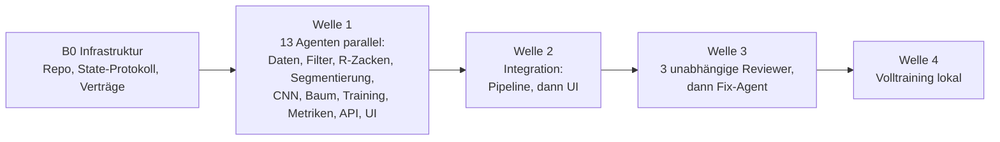

# EKG-Arrhythmie-Erkennung auf MIT-BIH (AAMI EC57, inter-patient)

**Deutsch** · [English](README.en.md)

Ein kompaktes 1D-CNN und ein interpretierbarer Entscheidungsbaum ordnen einzelne Herzschläge aus
der MIT-BIH Arrhythmia Database den fünf AAMI-EC57-Klassen **N, S, V, F, Q** zu – streng
**inter-patient** ausgewertet (Training und Test an verschiedenen Personen) und gebaut mit
**orchestrierten KI-Agenten**.

**Live-Demo:** <https://leonrohrer.at/ekg-arrhythmia/> – zeigt jeden Schritt vom Rohsignal bis
zur Klasse, mit Diagrammen und echten Daten.


> Lern- und Portfolio-Projekt. **Kein Medizinprodukt**, nicht für Diagnosen geeignet.

## Auf einen Blick

| | |
|---|---|
| **Daten** | MIT-BIH Arrhythmia Database (PhysioNet), Ableitung MLII, 360 Hz. 44 von 48 Records; die 4 Schrittmacher-Records (102, 104, 107, 217) sind nach AAMI-Empfehlung ausgeschlossen. |
| **Split** | de Chazal et al. (2004): DS1 (22 Records) nur Training, DS2 (22 Records) nur Test. Kein Record liegt in beiden Mengen; nur 201 (DS1) und 202 (DS2) stammen von derselben Person, eine bekannte Eigenheit dieses Splits. |
| **Klassen** | N (normal, Schenkelblock, Ersatzschläge), S (supraventrikulär ektop), V (ventrikulär ektop), F (Fusion), Q (unklassifizierbar). |
| **Modelle** | `ECGNet1D` (3 Faltungsblöcke + RR-Zweig, 14 749 Parameter) und ein Entscheidungsbaum (Tiefe 4, 11 lesbare Merkmale). |
| **Hauptmetriken** | Sensitivität und PPV je Klasse, Macro-F1 über N/S/V/F. Accuracy ist keine Hauptzahl: Rund 89 % der Testschläge sind normal, ein Modell, das immer „N“ sagt, wirkt damit schon gut. |
| **Oberfläche** | Vite, Tailwind CSS v4, Mermaid; Deutsch/Englisch, hell/dunkel; statisch auf GitHub Pages. |

## Ergebnisse

Ausgewertet wird auf DS2 mit den R-Zacken-Positionen der Experten-Annotationen (wie bei
de Chazal). Die Tabellen zeigen die EC57-„Gross“-Statistik, also über alle Test-Records gepoolt,
mit der VEB-Regel der Norm: Echte Fusionsschläge, die als V erkannt werden, zählen für V nicht
als Fehlalarm.

<!-- METRICS:START -->
<!-- vorläufig: Werte aus web/public/data/metrics.json (generated_at 2026-11-02T11:06:14+00:00, zweite DS2-Auswertung, siehe Methodik-Transparenz). Die Haupt-Session ersetzt diesen Block nach der finalen DS2-Auswertung (Plan A7). Die de-Chazal-Spalte (Literaturwerte, Quelle siehe unten) beim Ersetzen beibehalten. -->

> **Vorläufig.** Diese Werte stammen aus der zweiten Auswertung von DS2 und werden nach der
> einmaligen finalen Auswertung ersetzt (siehe [Methodik-Transparenz](#methodik-transparenz)).

**1D-CNN** (Validierung auf den DS1-Records 114, 119, 122, 201; bestes Modell nach Epoche 2 von 7):

| Klasse | Sensitivität | PPV | F1 | Schläge in DS2 |
|---|---:|---:|---:|---:|
| N | 92,0 % | 97,5 % | 94,7 % | 44 240 |
| S | 69,0 % | 40,2 % | 50,8 % | 1 837 |
| V | 79,2 % | 93,6 % | 85,8 % | 3 220 |
| F | 1,0 % | 0,2 % | 0,3 % | 388 |
| Q | 0,0 % | 0,0 % | 0,0 % | 7 |

- **Macro-F1 (N/S/V/F): 0,579** · Macro-F1 über alle 5 Klassen: 0,463
- Accuracy 89,6 % – zum Vergleich: „immer N“ erreicht 89,0 %.
- Größte Fehlerquelle: 2 018 normale Schläge werden als F erkannt, F selbst wird praktisch nie
  getroffen.

Konfusionsmatrix des CNN (Zeilen = wahre Klasse, Spalten = Vorhersage):

| | N | S | V | F | Q |
|---|---:|---:|---:|---:|---:|
| **N** | 40 691 | 1 496 | 35 | 2 018 | 0 |
| **S** | 391 | 1 268 | 139 | 39 | 0 |
| **V** | 252 | 387 | 2 550 | 31 | 0 |
| **F** | 380 | 2 | 2 | 4 | 0 |
| **Q** | 6 | 1 | 0 | 0 | 0 |

**Entscheidungsbaum** (Tiefe 4, auf ganz DS1 trainiert): Macro-F1 (N/S/V/F) 0,356.
Sensitivität / PPV: N 60,0 % / 95,0 % · S 7,1 % / 1,9 % · V 82,4 % / 54,9 % · F 1,8 % / 0,1 %.
Der Baum ist bewusst klein und lesbar; er zeigt, wie weit einfache Merkmale tragen, vor allem
bei V.

**Kreuzvalidierung nur auf DS1** (5 record-gruppierte Folds × 3 Seeds, Macro-F1 N/S/V/F,
Mittelwert ± Standardabweichung): `base` 0,459 ± 0,020 · `rr` 0,463 ± 0,023 ·
`patient` 0,481 ± 0,024. Das ist die Ausgangslage für alle weiteren Modellentscheidungen.

**R-Zacken-Detektion** (Pan-Tompkins, nur Record 100, Toleranz ±150 ms): 2 273 von 2 273
Schlägen gefunden, 0 Fehldetektionen. Ein einzelner Record ist kein Benchmark.

### Vergleich mit de Chazal et al. (2004)

| Kennzahl | dieses Projekt (CNN, vorläufig) | de Chazal et al. 2004 |
|---|---:|---:|
| N Sensitivität | 92,0 % | 86,9 %¹ |
| N PPV | 97,5 % | 99,2 %¹ |
| S Sensitivität | 69,0 % | 75,9 % |
| S PPV | 40,2 % | 38,5 % |
| V Sensitivität | 79,2 % | 77,7 % |
| V PPV | 93,6 % | 81,9 % |

Im vorläufigen Lauf liegt das CNN bei V und bei der S-PPV auf ähnlichem oder höherem Niveau,
bei der S-Sensitivität darunter. Die Zahlen sind nur eingeschränkt vergleichbar (Bedingungen
siehe unten).

¹ N-Werte aus einer Sekundärquelle, siehe unten.
<!-- METRICS:END -->

**Quelle und Bedingungen des Vergleichs.** P. de Chazal, M. O'Dwyer, R. B. Reilly: *Automatic
Classification of Heartbeats Using ECG Morphology and Heartbeat Interval Features.* IEEE
Transactions on Biomedical Engineering 51(7), 1196–1206, 2004.
[doi:10.1109/TBME.2004.827359](https://doi.org/10.1109/TBME.2004.827359). Die Werte für S und V
stehen im Abstract der Arbeit. Die N-Werte stammen aus der Vergleichstabelle von Tan et al. 2019
([arXiv:1906.07361](https://arxiv.org/abs/1906.07361), Tabelle VI); die Originaltabelle habe ich
nicht eingesehen. Gleich sind Split (DS1 → DS2), Klassen, EC57-Konventionen und die Verwendung
der Experten-R-Zacken. Anders: de Chazal nutzt **zwei** Ableitungen und lineare Diskriminanten auf
handgebauten Merkmalen, dieses Projekt nur MLII und ein CNN. Außerdem wurde DS2 hier vor dem
finalen Lauf bereits mehrfach ausgewertet.

## Grenzen

- **Kleine Datenbasis.** Die MIT-BIH-Datenbank umfasst 48 Records von 47 Personen, aufgenommen
  1975–1979; genutzt werden 44, getestet wird auf 22. Das Ergebnis sagt wenig darüber, wie das
  Modell auf anderen Geräten, Ableitungen oder Patientengruppen arbeitet. Ein externer Test
  (z. B. MIT-BIH Supraventricular Arrhythmia Database) ist angedacht, aber noch nicht gemacht.
- **F ist praktisch nicht lernbar.** 373 der 415 F-Schläge in DS1 stammen aus einem einzigen
  Record (208). Das Modell sieht damit im Kern die Fusionsschläge einer Person.
- **Q ist nicht sinnvoll auswertbar.** Nach dem Ausschluss der Schrittmacher-Records bleiben 8
  Q-Schläge in DS1 und 7 in DS2. Deshalb ist Macro-F1 über N/S/V/F die Hauptzahl.
- **Referenz-R-Zacken.** Die Hauptauswertung nutzt die Schlagpositionen der Experten. Eine
  vollautomatische Kette mit Pan-Tompkins (`--detected-peaks`) ist eingebaut, auf DS2 aber noch
  nicht ausgewertet.
- **Eine Ableitung, offline.** Nur MLII. Die patientenrelativen Merkmale (`--features patient`)
  nutzen Statistiken über den ganzen Record, also Holter-Auswertung im Nachhinein, nicht
  Echtzeit.
- **Instabiles Training.** Die Modellauswahl auf wenigen Validierungs-Records schwankt stark
  zwischen Seeds und Folds (Details in [docs/EXPERIMENTS.md](docs/EXPERIMENTS.md)).
- **Kein Medizinprodukt.** Nicht klinisch validiert, nicht für Diagnose oder Therapie.

## Methodik-Transparenz

Der Test-Split DS2 soll genau einmal ausgewertet werden, ganz am Ende. Das ist hier bisher nicht
gelungen, und das gehört offen dazu:

1. **Erster Lauf:** CNN mit Validierung auf den DS1-Records 114, 122, 201 und 208, Auswertung auf
   DS2.
2. **Zweiter Lauf:** Danach fiel auf, dass Record 208 rund 90 % aller F-Schläge von DS1 enthält
   und in der Validierung dem Training fehlte. Die neue Regel („kein Record mit ≥ 40 % einer
   Klasse in der Validierung“) wurde nur aus DS1-Zählungen abgeleitet. Neu trainiert wurde aber
   in Kenntnis des ersten DS2-Ergebnisses, und DS2 wurde ein zweites Mal ausgewertet. Die
   aktuellen Zahlen stammen aus diesem zweiten Lauf und sind deshalb leicht optimistisch und
   **vorläufig**.
3. **Danach:** Merkmalsvarianten wurden nur noch per Kreuzvalidierung auf DS1 verglichen. Die
   beste Variante (`patient`) verfehlte die vorab festgelegte Schwelle knapp und wurde nicht
   übernommen; DS2 wurde dafür nicht angefasst.

**Regel ab jetzt** (Details in [docs/EXPERIMENTS.md](docs/EXPERIMENTS.md) und
[docs/PLAN.md](docs/PLAN.md)):

- Alle Entscheidungen (Merkmale, Gewichte, Schwellen, Epochen) fallen über die record-gruppierte
  5-fach-Kreuzvalidierung auf DS1 mit 3 Seeds.
- Das Kriterium steht vorher fest: Eine Variante ersetzt die Basis nur, wenn ihr mittlerer
  Macro-F1 (N/S/V/F) mindestens eine Standardabweichung höher liegt und die N-Sensitivität nicht
  sinkt.
- Jedes Experiment wird mit Datum, Konfiguration und Ergebnis protokolliert.
- Die finale Konfiguration wird vor der Auswertung committet. DS2 wird dann **genau einmal**
  ausgewertet und berichtet, egal wie das Ergebnis ausfällt.

## Gebaut mit KI-Agenten

Das Projekt ist auch ein Versuch, ein Software-Projekt mit vielen KI-Agenten gleichzeitig zu
bauen, ohne dass Ergebnisse und Code auseinanderlaufen. Ein Orchestrator („Mother-Agent“, Claude)
zerlegt die Arbeit in Module und startet dafür Sub-Agenten, bis zu 16 parallel. Plan, Verträge und
Status liegen als Dateien im Repo: [MASTERPLAN.md](MASTERPLAN.md),
[INTERFACES.md](INTERFACES.md) und [project_state.json](project_state.json).

### Ablauf



- **B0:** Der Orchestrator legt Repo, State-Protokoll und Verträge an.
- **Welle 1:** 13 Agenten bauen gleichzeitig Datenlader, Filter, R-Zacken-Detektion,
  Segmentierung, CNN, Baum, Trainingsschleife, Metriken, API-Server und die UI-Bausteine. Jeder
  Agent hat eigene, sich nicht überschneidende Dateien.
- **Welle 2:** Integration der Pipeline (CLI, Web-Export, Tests), danach der Oberfläche (Build,
  Browser-Tests in hell/dunkel, Desktop/Handy).
- **Welle 3:** Drei Reviewer prüfen unabhängig ML-Korrektheit und Leakage, Tests, UI und die
  Ehrlichkeit der Aussagen. Ein Fix-Agent hat alle 17 Befunde reproduziert und behoben, z. B.
  die Schwellen-Erholung im Pan-Tompkins-Detektor, die QRS-Breite, gedeckelte Klassengewichte und
  einen Cache-Schlüssel mit Code-Hash.
- **Welle 4:** In der Cloud-Umgebung war physionet.org gesperrt, deshalb gab es dort keine
  Kennzahlen. Das Volltraining lief danach lokal unter Windows, inklusive Portierung des
  Datei-Locks.

### Regeln für die Zusammenarbeit

- **Ownership:** Jedes Modul besitzt exklusiv die Dateien unter `owns` in `project_state.json`.
  Fremde Dateien werden nicht editiert.
- **Verträge:** `INTERFACES.md` legt Funktionssignaturen, Datenformate und Design-Tokens fest.
  Wer abweichen muss, protokolliert das mit `state.py log` statt still zu ändern; die
  Erweiterungen stehen nachlesbar im Verlauf jedes Moduls.
- **State-Lock:** `project_state.json` wird nur über `scripts/state.py` geändert: Datei-Lock
  (`fcntl` bzw. `msvcrt` unter Windows) und atomares Schreiben, damit parallele Agenten sich
  nicht gegenseitig überschreiben.
- **Abhängigkeiten:** Der Orchestrator startet ein Modul erst, wenn alle `depends_on` erledigt
  sind. Scheitert ein Modul (`state.py fail` mit Log-Auszug), wird die Anweisung korrigiert und
  das Modul neu gestartet.
- **Nachweis:** Jeder Abschluss enthält Zusammenfassung, Entscheidungen, geänderte Dateien und
  die ausgeführten Tests mit Ergebnis. Die Status-Seite der Web-Oberfläche zeigt diesen Stand.

### Was ich selbst entschieden und geprüft habe

- **Ziel und Leitplanken:** Aufgabe und Rahmen (EC57-Klassen, inter-patient nach de Chazal, CNN
  plus interpretierbares Vergleichsmodell, nachvollziehbare Oberfläche) sowie die Regel, keine
  erfundenen oder geschönten Zahlen zu zeigen und Schwächen zu benennen.
- **Lokale Phase:** Daten und Volltraining auf meinem Rechner, nachdem die Cloud-Umgebung die
  Datenbank nicht laden konnte.
- **Kurs nach den ersten Ergebnissen:** erst das Modell verbessern, dann veröffentlichen; DS2
  bleibt bis zur finalen Auswertung gesperrt ([docs/PLAN.md](docs/PLAN.md)).
- **Kontrolle:** Kennzahlen in Texten gegen die exportierten Ergebnisse prüfen; das Repo wird erst
  nach einer Prüfung auf private Daten öffentlich.

### Agenten-Protokoll (Kurzfassung)

```bash
python scripts/state.py start <modul> --agent <name>
python scripts/state.py done  <modul> --agent <name> --summary "…" --decision "…" --file <pfad> --test "<befehl>: <ergebnis>"
python scripts/state.py fail  <modul> --agent <name> --error "<log-auszug>"
python scripts/state.py log   <modul> --agent <name> --note "Abweichung vom Vertrag …"
python scripts/state.py show  [<modul>]
```

## Architektur

```
Rohsignal (MLII, 360 Hz)
  → Baseline-Entfernung (Median 200 ms, dann 600 ms)
  → Bandpass 0,5–40 Hz (Butterworth 4. Ordnung, nullphasig)
  → R-Zacken (Experten-Annotationen; alternativ Pan-Tompkins)
  → Segmentierung (250 ms vor / 450 ms nach R = 252 Samples, z-normiert) + 4 RR-Merkmale
  → ECGNet1D (3 × Conv1d/BN/ReLU/MaxPool, 16/32/64 Kanäle, RR-Zweig)
    und Entscheidungsbaum (11 interpretierbare Merkmale, Tiefe 4)
  → AAMI-Klasse N/S/V/F/Q → Sensitivität, PPV, F1 je Klasse, Macro-F1
```

| Paket | Inhalt |
|---|---|
| `ekg.data.loader` | Records laden (wfdb), AAMI-Mapping, DS1/DS2-Split, Download |
| `ekg.preprocessing.filters` | Baseline-Entfernung, Bandpass, Notch, Frequenzgang |
| `ekg.preprocessing.rpeaks` | Pan-Tompkins-Detektor, Zwischenstufen, Abgleich mit Referenz |
| `ekg.preprocessing.segmentation` | Schlagfenster, RR-Merkmale, `BeatSet` |
| `ekg.preprocessing.patient_features` | RR und Schlagform relativ zum eigenen Record |
| `ekg.models.cnn1d` | `ECGNet1D`, Architektur-Beschreibung |
| `ekg.models.tree_baseline` | Merkmale, Entscheidungsbaum, Export (JSON/Mermaid) |
| `ekg.training.train` | Trainingsschleife (gedeckelte Klassengewichte, Early Stopping, Cosine-Schedule, Augmentierung) |
| `ekg.evaluation.metrics` | Konfusionsmatrix, AAMI-Metriken, Gross-/Average-Statistik mit VEB-Regel |
| `ekg.pipeline` | CLI: `demo`, `prepare`, `train`, `cv`, `smoke`, `export-state` |
| `ekg.api.server` | FastAPI: `/api/health`, `/api/state`, `/api/data/{name}`, gebaute UI |

Die Web-Oberfläche (`web/`) hat vier Ansichten: **Übersicht** (mit Rhythmus-Player auf
Record 100), **Process** (jeder Schritt mit Diagramm, echten Daten und Verweis auf den Code),
**Modelle** (CNN und Baum gegen Zufalls-Baselines) und **Agenten-Status** (aus
`project_state.json`). Die Live-Seite wird per [GitHub Actions](.github/workflows/pages.yml)
statisch gebaut (`VITE_STATIC_SITE=1`, ohne API).

## Quickstart

Voraussetzungen: Python ≥ 3.11 und Node.js ≥ 18. Getestet unter Linux (Cloud-Container) und
Windows 11 mit Python 3.13.

**Linux/macOS** (mit `make`):

```bash
make install   # .venv, pip install -c constraints.txt -e . pytest, npm ci
make test      # Python-Tests
make demo      # Web-Exporte aus Record 100 nach web/public/data
make web       # UI bauen (web/dist)
make serve     # http://127.0.0.1:8000 (API + UI)
```

**Windows** (PowerShell, ohne `make`): Die Makefile-Befehle direkt ausführen; der Python der
venv liegt unter `.venv\Scripts\python.exe` statt `.venv/bin/python`.

```powershell
python -m venv .venv
.venv\Scripts\python.exe -m pip install -c constraints.txt -e . pytest
cd web; npm ci; cd ..
.venv\Scripts\python.exe -m pytest -q
.venv\Scripts\python.exe -m ekg.pipeline demo --record data/sample/100 --out web/public/data --data-dir data/mitdb
cd web; npm run build; cd ..
.venv\Scripts\python.exe -m ekg.api.server --port 8000
```

`constraints.txt` hält die getesteten Paketversionen aus dem Linux-Container fest. Gibt es eine
Version für das eigene System nicht, ohne `-c constraints.txt` installieren. `train` und `cv`
schreiben die tatsächlich verwendeten Versionen in ihre Ausgabe (`config.library_versions`).
Für die Entwicklung startet `cd web; npm run dev` die UI mit Hot Reload; `/api` wird an Port 8000
weitergeleitet.

## Befehle

Alle Befehle aus dem Repo-Root. Unter Windows `python` durch `.venv\Scripts\python.exe` ersetzen.

| Zweck | `make` | direkt |
|---|---|---|
| MIT-BIH laden (~100 MB, nach `data/mitdb`) | `make data` | `python scripts/download_mitdb.py --data-dir data/mitdb` |
| Web-Exporte aus Record 100 | `make demo` | `python -m ekg.pipeline demo --record data/sample/100 --out web/public/data --data-dir data/mitdb` |
| Mechanik-Test (1 Epoche, nur `artifacts/smoke/`) | `make smoke` | `python -m ekg.pipeline smoke --record data/sample/100 --out artifacts/smoke` |
| Beat-Cache für DS1/DS2 | `make prepare` | `python -m ekg.pipeline prepare --data-dir data/mitdb --cache artifacts/beats` |
| Kreuzvalidierung nur auf DS1 | `make cv FEATURES=base` | `python -m ekg.pipeline cv --data-dir data/mitdb --features base` |
| Training DS1, **Auswertung DS2** | `make train EPOCHS=20` | `python -m ekg.pipeline train --data-dir data/mitdb --out artifacts --export web/public/data --epochs 20` |
| Status für die UI kopieren | `make state` | `python -m ekg.pipeline export-state --out web/public/data` |

> `train` wertet auf DS2 aus. Im Projekt passiert das nur noch einmal, mit der eingefrorenen
> finalen Konfiguration (siehe [Methodik-Transparenz](#methodik-transparenz)). Für alle
> Experimente ist `cv` da.

`prepare` und `train` brechen mit Exit-Code 2 und einer Liste der fehlenden Records ab, solange
DS1/DS2 nicht vollständig vorliegen. `demo` überschreibt ein vorhandenes `metrics.json` oder
`dataset_stats.json` mit `status: "complete"` nicht (außer mit `--force`).

### Optionen von `cv`

`cv` trainiert das CNN record-gruppiert in k Folds nur auf DS1 (DS2 wird nie geladen), poolt die
Out-of-fold-Vorhersagen je Seed und berichtet Mittelwert ± Standardabweichung über die Seeds.
Ausgabe: `artifacts/cv/cv_<features>[_<tag>].json`.

| Option | Standard | Wirkung |
|---|---|---|
| `--features base\|rr\|patient` | `base` | Zusatzeingaben des CNN: 4 RR-Merkmale; `rr` plus RR relativ zum Record-Mittel; `patient` zusätzlich Abweichung vom Median-Schlag des Records |
| `--folds K` / `--seeds S …` | `5` / `0 1 2` | Anzahl Folds und Seeds |
| `--epochs N` / `--patience P` | `20` / `5` | Maximale Epochen; Early Stopping (`0` = aus) |
| `--n-val N` | `3` | Validierungs-Records je Fold für Early Stopping. **`--n-val 0`**: keine Validierung, genau `--epochs` Epochen |
| `--eval-epochs E …` | – | Out-of-fold-Auswertung zusätzlich nach diesen Epochen (`by_epoch` im Bericht), um aus einem Lauf eine feste Epochenzahl zu wählen |
| `--lr-schedule cosine` | aus | Cosine-Lernratenplan |
| `--augment` | aus | Amplitude ±10 %, Gaußrauschen (σ = 0,05 in z-Einheiten), Zeitverschiebung ±3 Samples |
| `--tag NAME` | – | Namenszusatz der Ausgabedatei, damit Varianten sich nicht überschreiben |
| `--max-class-share X` | `0.4` | Records mit mindestens diesem Anteil einer Klasse kommen nie in die Validierung |
| `--detected-peaks` | aus | Pan-Tompkins-R-Zacken statt Experten-Annotationen |

Beispiele:

```bash
# feste Epochenzahl ohne Validierung, Auswertung nach 5/10/15/20 Epochen
python -m ekg.pipeline cv --features base --n-val 0 --epochs 20 --eval-epochs 5 10 15 20 --tag fixed
# Cosine-Schedule mit Augmentierung
python -m ekg.pipeline cv --features base --n-val 0 --epochs 15 --lr-schedule cosine --augment --tag cos_aug
```

## Projektstruktur

```
├── MASTERPLAN.md          Blöcke, Wellen, Abhängigkeiten der Agenten
├── INTERFACES.md          bindende Schnittstellen zwischen den Modulen
├── project_state.json     zentrale Status-Datei (nur über scripts/state.py ändern)
├── Makefile
├── constraints.txt        getestete Python-Paketversionen
├── data/sample/           echter MIT-BIH-Record 100
├── data/mitdb/            vollständige Datenbank (nach `make data`, nicht im Repo)
├── docs/
│   ├── PLAN.md            Fahrplan bis zur Veröffentlichung
│   ├── EXPERIMENTS.md     Experiment-Protokoll (Regeln, CV-Läufe)
│   └── screenshots/
├── scripts/
│   ├── state.py           lock-sicheres Status-Protokoll für Agenten
│   └── download_mitdb.py  Download der MIT-BIH-Datenbank
├── src/ekg/               Python-Paket (siehe Tabelle oben)
├── tests/                 pytest (synthetische Signale und Record 100)
├── artifacts/             Modelle, Caches, CV-Berichte (nicht im Repo)
└── web/
    ├── public/data/       JSON-Exporte der Pipeline für die UI
    └── src/               Ansichten, Diagramme, Charts, Process-Inhalte
```

## Lizenz und Daten

- **Code:** MIT-Lizenz, siehe [LICENSE](LICENSE).
- **Daten:** MIT-BIH Arrhythmia Database von PhysioNet, Lizenz Open Data Commons Attribution
  (ODC-By) 1.0; sie fallen nicht unter die MIT-Lizenz. Der Record 100 unter `data/sample/` sowie
  die daraus abgeleiteten Web-Exporte und Screenshots stammen aus dieser Datenbank. Die
  vollständige Datenbank ist nicht im Repo, sondern wird mit `make data` von PhysioNet geladen.
  Details und Quellenangabe: [DATA_LICENSE.md](DATA_LICENSE.md).

## Quellen

- G. Moody, R. Mark: MIT-BIH Arrhythmia Database (Version 1.0.0). PhysioNet, 2005.
  [doi:10.13026/C2F305](https://doi.org/10.13026/C2F305)
- G. B. Moody, R. G. Mark: The impact of the MIT-BIH Arrhythmia Database. *IEEE Engineering in
  Medicine and Biology* 20(3), 45–50, 2001.
- A. L. Goldberger et al.: PhysioBank, PhysioToolkit, and PhysioNet. *Circulation* 101(23),
  e215–e220, 2000.
- P. de Chazal, M. O'Dwyer, R. B. Reilly: Automatic Classification of Heartbeats Using ECG
  Morphology and Heartbeat Interval Features. *IEEE Trans. Biomed. Eng.* 51(7), 1196–1206, 2004.
- J. Pan, W. J. Tompkins: A Real-Time QRS Detection Algorithm. *IEEE Trans. Biomed. Eng.* 32(3),
  230–236, 1985.
- ANSI/AAMI EC57: Testing and reporting performance results of cardiac rhythm and ST segment
  measurement algorithms.
